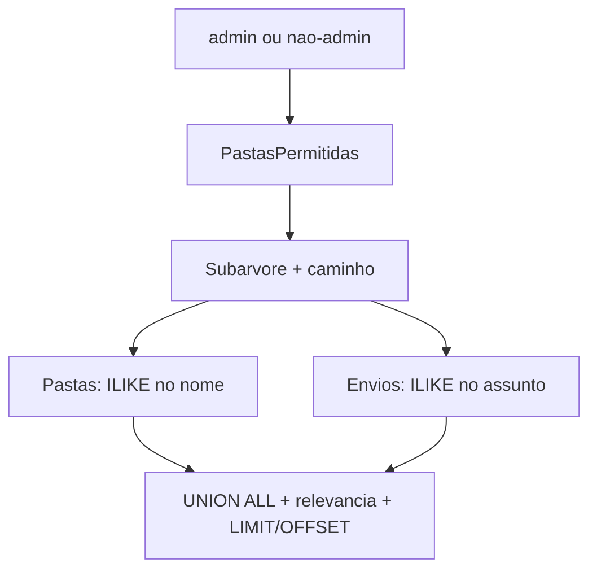

# Solução: busca recursiva via SQL

Esta branch resolve o ticket *"No arcSing a busca do arquivo tem que ser recursiva nas
pastas"*. O estado anterior está na `main` e é descrito em `PROBLEMA.md` lá.

Para ver só o que mudou:

```bash
git diff main..busca-recursiva
```

---

## O problema, em uma frase

A busca era client-side: o frontend filtrava em memória o nível já carregado, e a API
nunca recebia o termo. Achar um documento a três níveis de profundidade exigia abrir
pasta por pasta.

## A abordagem escolhida

Um **endpoint dedicado de busca** que executa **uma query SQL** no PostgreSQL. A
recursão, o filtro de permissão e o caminho legível são resolvidos no banco, não em
loops no .NET.

```
GET /api/envio/conta/{externalKeyConta}/buscar
    ?termo={texto}
    &externalKeyPasta={guid?}   # vazio = raiz da conta
    &incluirPastas=true
    &pagina=1
    &tamanhoPagina=50
```

O endpoint de navegação (`/itens`) continua listando um nível só. A busca é que
atravessa a árvore.

### Listagem paginada

Com a busca resolvida, sobrou a pasta grande: abrir uma pasta com milhares de envios
trazia todos numa resposta e o front desenhava todos. `/itens` passou a paginar como
`/buscar` (`pagina`, `tamanhoPagina`, total por `COUNT(*) OVER ()`), e o front ganhou
um paginador: cada troca de página é uma nova requisição.

Faltava também um índice em `destinatario (idenvio)`. As duas queries montam a lista de
destinatários de cada envio com um `LEFT JOIN LATERAL`, e sem o índice cada envio varre
a tabela `destinatario` inteira.

Medido com `node gerar-volume.mjs --quantidade 5000 --pasta-grande 5000` (cerca de
10.000 envios, 5.000 deles em `Clientes > Volume > Arquivo_Geral`), como a Ana, com o
front servido por `vite preview`. "Abrir a pasta grande" é do clique até as linhas
desenhadas, mediana de 5 rodadas no Chromium headless:

| Situação | Abrir a pasta grande | Resposta de `/itens` |
|---|---|---|
| Sem paginação, sem índice | 3,3 s | 5.000 itens, 1,1 MB |
| Só paginação | 2,3 s | 50 itens, 11 KB |
| Só o índice | 1,4 s | 5.000 itens, 1,1 MB |
| Paginação + índice | 0,38 s | 50 itens, 11 KB |

O índice também derruba a busca ampla: `termo=vol-` (10.000 resultados) cai de 4,4 s
para 0,55 s, e `termo=contrato` de 1,5 s para 1,0 s.

### Por que no banco, e não na aplicação

| Alternativa | Por que não |
|---|---|
| N queries, uma por nível | Round-trips proporcionais à profundidade; impagável com milhares de pastas |
| Carregar a árvore e filtrar em memória | Cada tecla puxa a conta inteira pela rede para devolver 3 itens |
| **Uma CTE recursiva** | O banco faz o trabalho pesado; a rede transporta só a página de resultado |

O padrão `WITH RECURSIVE` já existia no projeto para resolver permissões, então a
solução reaproveita algo conhecido em vez de introduzir uma peça nova.

Contrapartidas assumidas: um endpoint, um handler, um método de repositório e um
cliente HTTP a mais para manter.

## A query, em três CTEs

Está em `api/BuscaApi.Infrastructure/Repositorios/Queries/QueriesEnvio.cs`, na
constante `QueryBuscaArquivos`.



**1. `PastasPermitidas`** — quem o usuário pode ver.

Admin (`idUsuarioFiltro` nulo) recebe todas as pastas da conta. Para os demais, parte
das pastas em `rlcusuariopasta` e **desce** para os filhos: ter acesso a `Financeiro`
implica ver `Contratos` e `Notas Fiscais`.

É a mesma CTE que a navegação já usava.

**2. `Subarvore`** — onde procurar.

Parte da pasta atual (ou das raízes da conta) e desce até as folhas, cruzando com
`PastasPermitidas` a cada passo. Como o filtro de permissão entra **antes** da
expansão, uma pasta proibida nunca chega a ser visitada — não é uma filtragem
posterior que poderia vazar.

Na descida, monta o `caminho` concatenando os nomes: `Clientes > 2026 > ACME`.

**3. `Pastas` + `Envios`** — o que casa com o termo.

`ILIKE '%termo%'` no nome da pasta e no assunto do envio. Destinatários entram por
`STRING_AGG` num `LEFT JOIN LATERAL`. Os dois se unem, ordenam por relevância
(match exato, depois prefixo, depois o resto) e paginam com `LIMIT`/`OFFSET`. O total
vem de `COUNT(*) OVER ()`, evitando uma segunda ida ao banco.

Detalhe: a própria pasta de partida é excluída dos resultados. Buscar `contratos`
dentro de `Contratos` não deve devolver a pasta em que você já está.

### Índices

Em `db/03_indices.sql`, aplicados como migration separada do schema:

- `pg_trgm` + GIN em `envio.assunto` e `pasta.nomepasta` — sem isso o `%` inicial do
  `ILIKE` impede qualquer B-tree e a busca vira sequential scan.
- B-tree em `pasta.idpastapai` — acelera a descida das duas CTEs.
- B-tree em `envio (idpasta, statusregistro)` — acelera os envios da subárvore.

### Frontend

- Debounce de 300 ms e mínimo de 2 caracteres: sem isso, digitar uma palavra viraria
  uma query por tecla, e uma única letra casaria quase tudo.
- Cada resultado mostra o caminho, porque o item pode estar em qualquer profundidade.
- Durante a busca o breadcrumb some e clicar numa pasta não navega: o resultado não
  pertence ao nível atual.
- Requisições em voo são canceladas via `AbortController` quando o termo muda.

## O que a solução deliberadamente não faz

- Não carrega a árvore na aplicação para filtrar em memória.
- Não faz N queries (uma por nível).
- Não é full-text search (`tsvector`, ranking linguístico). Continua sendo substring.
- Não elimina o custo com dezenas de milhares de matches: o `COUNT(*) OVER ()` e a CTE
  ainda percorrem a subárvore permitida. O volume simulado existe para expor esse
  limite, não para escondê-lo.

## Como validar

Suba o banco e esta stack (ver [INSTRUCOES.md](INSTRUCOES.md)) e abra
http://localhost:5174.

| Cenário | Esperado |
|---|---|
| Ana, campo vazio | Navegação: `Clientes`, `Financeiro`, `RH` |
| Ana, `contrato` na raiz | Envios em `Clientes > 2026 > ACME`, `Clientes > 2025 > Initech`, `Financeiro > Contratos`, `RH > Admissoes` |
| Ana, `ACME` na raiz | A pasta `ACME` aparece **uma vez**, com os envios dela |
| Ana, `Financeiro` na raiz | A pasta-raiz `Financeiro` aparece nos resultados |
| Maria, `contrato` na raiz | Só o ramo Financeiro; nada de `Clientes` |
| Ana, dentro de `Financeiro`, `contrato` | Resultados do ramo, sem a própria `Financeiro` |
| Digitar 1 caractere | Não dispara requisição |
| Digitação rápida | Uma única requisição (debounce de 300 ms, ver aba Network) |

Com o volume gerado (`cd scripts && npm install && node gerar-volume.mjs`), `Vol-` na
raiz é o pior caso: ~10.000 envios casando, paginados de 50 em 50.

Para comparar lado a lado, suba a `main` em paralelo (porta 5173) e busque `contrato`
na raiz nas duas: lá o resultado é vazio.

## Pendências conhecidas

Levantadas na validação do ticket e **não** implementadas aqui:

- O debounce reduz, mas não elimina, a sensação de digitação lenta. Foi sugerido
  disparar a busca só no Enter ou no clique na lupa.
- Não há realce do trecho que casou com o termo no resultado.
